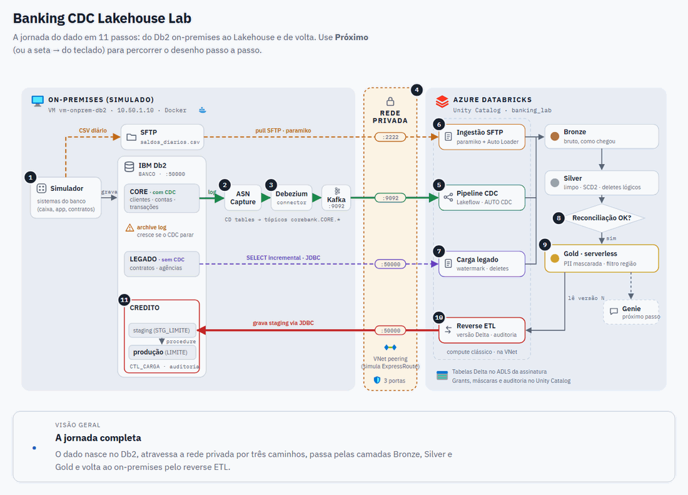
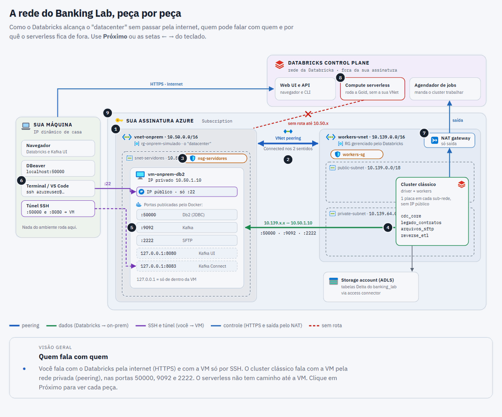
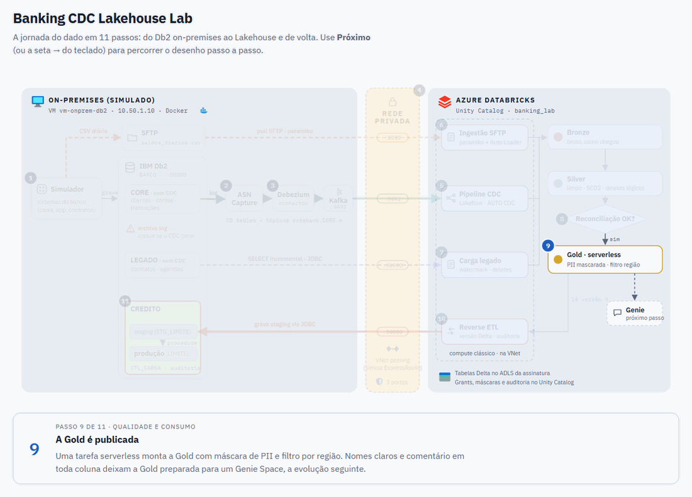
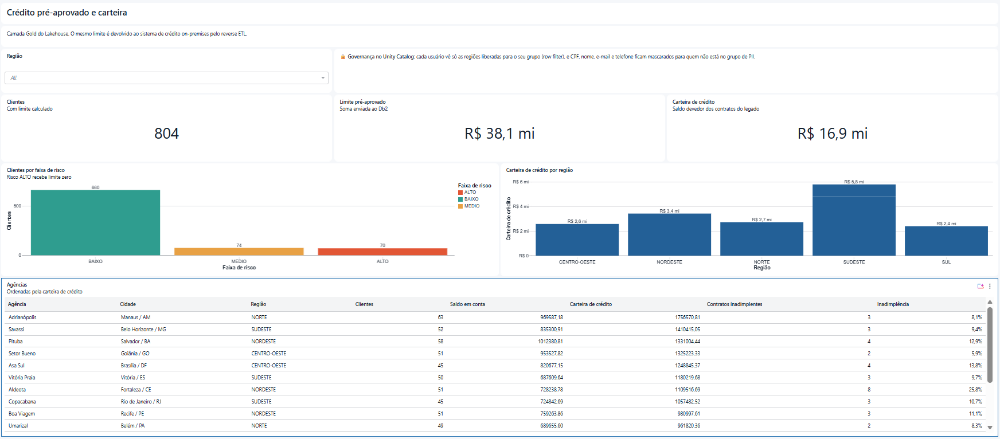
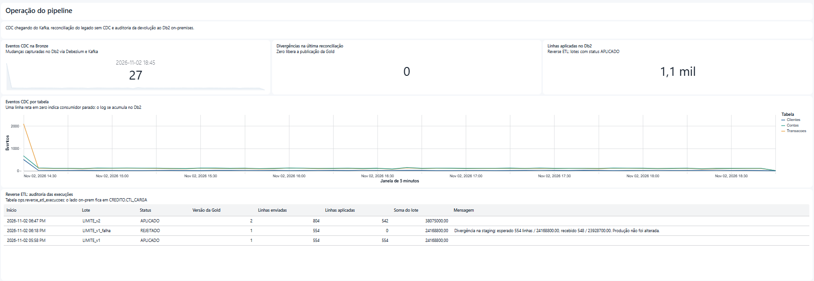
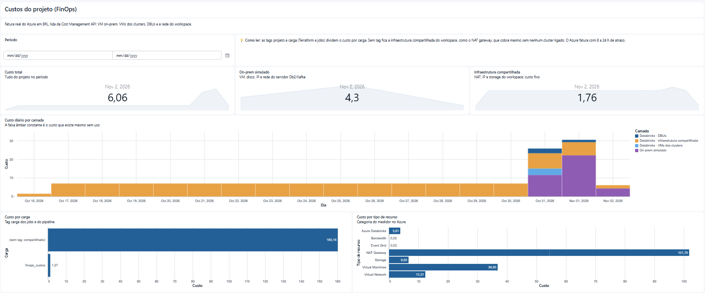

# Banking CDC Lakehouse Lab

Laboratório hands-on que simula a migração da plataforma de dados de um **banco regulado** —
sistemas legados on-premises (Unix, IBM Db2, arquivos CSV em batch) — para **Azure Databricks
com Unity Catalog**, cobrindo os três problemas que mais aparecem nesse tipo de projeto:

1. **CDC com Kafka** — levar mudanças do banco transacional ao Lakehouse sem derrubar a origem.
2. **Reverse ETL** — devolver dados tratados para a rede on-premises com segurança, sem travar
   tabelas de produção e com auditoria. **(destaque do laboratório)**
3. **Fontes legadas sem CDC** — carga incremental via JDBC, detecção de deletes e reconciliação.

O "on-premises" é um **servidor Linux real** numa rede isolada (VNet própria no Azure, sem IP
público nas portas de dados), rodando **IBM Db2 11.5 com ASN Capture, Kafka e Debezium**. O
Databricks alcança esse servidor **só por rede privada** (VNet peering, no papel do
ExpressRoute). Os dados são **100% sintéticos**, gerados por um simulador de movimento bancário.

> ⚠️ Nenhum dado de cliente real é usado neste repositório. Todos os CPFs, nomes e valores são
> gerados artificialmente.

## Em 1 minuto

- **CDC por log, não por consulta:** o ASN Capture lê o log do Db2 e grava as mudanças em
  tabelas CD; o Debezium publica essas mudanças no Kafka e o pipeline Lakeflow aplica com
  `AUTO CDC` (SCD2 em clientes). Com o Debezium parado, as mudanças se acumulam **dentro do
  Db2**: o Kafka só protege a origem quando quem para é o consumidor depois dele.
- **Reverse ETL sem tocar direto na produção:** o Databricks grava numa staging; uma procedure no
  Db2 valida contagem e soma e aplica em faixas, com lock timeout de 5 s. No teste de falha,
  **554 linhas esperadas, 548 recebidas: lote rejeitado e produção intocada**, com tudo
  registrado na auditoria dos dois lados.
- **Legado sem CDC:** JDBC incremental por marca d'água, detecção de deletes e reconciliação por
  contagens e somas. Divergência que persiste **bloqueia a Gold**.
- **Governança e custo:** PII mascarada por grupo no Unity Catalog, Gold com descrições de
  colunas para linguagem natural e custo real do Azure no dashboard.

---

## Sumário

- [Em 1 minuto](#em-1-minuto)
- [Arquitetura](#arquitetura)
- [O que é real e o que é simulado](#o-que-é-real-e-o-que-é-simulado)
- [Modelo de dados](#modelo-de-dados)
- [Cenário 1 — CDC com Kafka](#cenário-1--cdc-com-kafka)
- [Cenário 2 — Reverse ETL para o on-premises](#cenário-2--reverse-etl-para-o-on-premises)
- [Cenário 3 — Fontes legadas sem CDC](#cenário-3--fontes-legadas-sem-cdc)
- [Governança: PII, grupos e auditoria](#governança-pii-grupos-e-auditoria)
- [Camada Gold pronta para linguagem natural (Genie)](#camada-gold-pronta-para-linguagem-natural-genie)
- [Dashboard: crédito e operação do pipeline](#dashboard-crédito-e-operação-do-pipeline)
- [FinOps: custo real do projeto](#finops-custo-real-do-projeto)
- [Serverless: conectividade privada e custo](#serverless-conectividade-privada-e-custo)
- [E o Azure Data Factory?](#e-o-azure-data-factory)
- [Estrutura do repositório](#estrutura-do-repositório)
- [Como executar](#como-executar)

---

## Arquitetura



Versão interativa, com botão **Próximo** e a explicação de cada passo:
[abrir o diagrama da arquitetura](https://devalvess.github.io/banking-cdc-lakehouse-lab/arquitetura.html).

### Rede



O NSG do servidor on-prem só aceita as portas de dados (Db2 50000, Kafka 9092, SFTP 2222)
vindas da VNet do Databricks (`10.139.0.0/16`), e SSH só do IP do administrador. Nada de dados
passa pela internet. Versão interativa, com os comandos para conferir cada peça no Azure:
[abrir o diagrama da rede](https://devalvess.github.io/banking-cdc-lakehouse-lab/rede.html).

**Compute híbrido:** tarefas que conversam com o on-prem rodam em **cluster clássico** (está na
VNet com peering); a Gold, que só lê o Lakehouse, roda em **serverless**. Detalhes em
[Serverless](#serverless-conectividade-privada-e-custo).

Catálogo `banking_lab` no Unity Catalog, com um schema por responsabilidade:

| Schema | Conteúdo |
|---|---|
| `landing` | Volumes: CSVs trazidos do SFTP e checkpoints |
| `bronze` | Dado como chegou, append-only: eventos Debezium crus, extrações JDBC, CSVs |
| `silver` | Dado limpo com histórico (SCD tipo 2 em clientes). Área técnica: só engenharia |
| `gold` | Tabelas de negócio com PII mascarada, filtro por região e descrição em toda coluna |
| `ops` | Controle de marca d'água, reconciliação e auditoria do reverse ETL |
| `governanca` | Funções de máscara e filtro de linha, mapa grupo → região |

---

## O que é real e o que é simulado

| Componente no banco real | Neste laboratório | Diferença para produção |
|---|---|---|
| Datacenter + ExpressRoute/VPN | VNet isolada `vnet-onprem` + VNet peering | Só o meio físico; o modelo de rede (privado, portas mínimas) é o mesmo |
| Servidor Unix com IBM Db2 | VM Ubuntu com **Db2 11.5 Community** em container | Edição e sistema operacional |
| CDC por log (IIDR / SQL Replication) | **ASN Capture real** + Debezium Db2 connector | O mecanismo é o mesmo; em produção, exige licença do IBM InfoSphere Data Replication (IIDR) |
| Kafka corporativo / Confluent | Kafka 3.9 (KRaft, 1 nó) | Replicação, SASL_SSL e Schema Registry |
| Sistema legado sem CDC | Schema `LEGADO` no mesmo Db2 | Seria outro servidor/banco |
| Servidor SFTP do batch noturno | Container `atmoz/sftp` | Nenhuma relevante |
| Sistema de crédito (destino do reverse ETL) | Schema `CREDITO` no mesmo Db2 | Seria outro servidor/banco |
| Movimento real dos clientes | Simulador Python (Faker pt_BR) | Dados sintéticos |
| Cofre de senhas (CyberArk / Key Vault) | Secret scope `onprem` do Databricks | Key Vault-backed scope |
| Acesso governado ao banco on-prem | Fonte JDBC do Spark com credencial no secret scope | Avaliar uma conexão JDBC do Unity Catalog, que governa o acesso no nível da conexão |
| Grupos do Entra ID | Grupos de conta do Databricks | Sincronização via SCIM |

Tudo é criado por código: [Terraform](infra/terraform) para rede e VM,
[Docker Compose](onprem/docker-compose.yml) para o on-prem e
[Asset Bundle](databricks/databricks.yml) para o Databricks.

---

## Modelo de dados

Domínio: um banco de varejo com clientes, contas, transações e contratos de crédito.

| Entidade | Origem | Mecanismo de ingestão | PII |
|---|---|---|---|
| `clientes` | Core (Db2) | CDC — SCD tipo 2 | CPF, nome, e-mail, telefone, data de nascimento |
| `contas` | Core (Db2) | CDC — SCD tipo 1 | — |
| `transacoes` | Core (Db2) | CDC — SCD tipo 1 | — |
| `contratos_credito` | Legado sem CDC | JDBC incremental + detecção de deletes | — |
| `agencias` | Legado sem CDC | JDBC carga completa (tabela pequena) | — |
| `saldos_diarios` | CSV noturno no SFTP | SFTP (pull) + Auto Loader | — |

Tabelas Gold:

| Tabela | Uso |
|---|---|
| `gold.dim_cliente` | Cadastro vigente, **com máscara de PII** e filtro por região |
| `gold.posicao_cliente` | Saldo, crédito, atraso e movimentação de 30 dias por cliente |
| `gold.limite_pre_aprovado` | Limite de crédito por cliente — **é o dado devolvido ao on-prem** |
| `gold.resumo_agencia` | Indicadores por agência, sem PII — preparada para um Genie Space |

---

## Cenário 1 — CDC com Kafka

### Por que CDC por log e não consultas incrementais

| | CDC por log (Debezium, IIDR, ASN Capture) | Consulta incremental (`WHERE dt_atualizacao > :ultimo`) |
|---|---|---|
| Captura deletes | ✅ Sim, o delete está no log | ❌ Não — a linha simplesmente some |
| Captura todos os estados intermediários | ✅ Cada update vira um evento | ❌ Só o estado no momento da consulta |
| Depende de coluna de auditoria confiável | Não depende | Depende — e no legado ela frequentemente não é atualizada por todas as rotinas |
| Carga no banco de origem | Leitura sequencial do log | Varredura de índice/tabela a cada execução, competindo com o OLTP |
| Latência | Segundos | Intervalo do agendamento |
| Ordem das operações | Garantida (LSN/SCN) | Não garantida |

### CDC e o acúmulo de log no banco de origem

Colocar Kafka depois do CDC não reduz o log acumulado na origem: **o gargalo está antes do
Kafka.**

O Kafka é um buffer **depois** que o log foi lido. Quem segura o log no banco é o **leitor do log**
(o conector de CDC). Enquanto ele não confirma que leu uma posição, o banco **não pode reciclar**
aquele trecho de log:

| Banco | O que acumula | Por quê |
|---|---|---|
| Db2 (ASN Capture / SQL Replication) | Logs arquivados + tabelas de change data (CD) | O Capture precisa reler o log a partir do último ponto confirmado; as tabelas CD crescem se o *prune* não roda |
| SQL Server | Transaction log + tabelas `cdc.*` | O log não trunca enquanto o job de captura não processa |

Se o conector para, fica lento ou foi configurado para capturar tabelas demais, o log cresce na
origem — com ou sem Kafka na frente.

**No Db2 deste laboratório dá para ver isso acontecer.** O Debezium não lê o log diretamente: o
**ASN Capture** (processo do próprio Db2) lê o log e grava cada mudança em **tabelas CD dentro do
banco** (`ASNCDC.CDC_CORE_TRANSACOES`...); o Debezium lê dessas tabelas. Ou seja, habilitar CDC
no Db2 **cria tabelas que crescem no banco de produção**:

```
Db2 log ──► ASN Capture ──► tabelas CD (no Db2!) ──► Debezium ──► Kafka ──► Databricks
            └─ se parar, o log arquivado     └─ crescem até o prune limpar
               precisa ser retido
```

| Se parar... | O que acumula na origem | Mitigação |
|---|---|---|
| ASN Capture | Log arquivado (`/database/archive`) — o Capture precisa reler a partir do ponto de reinício | Alerta de atraso do Capture (`IBMSNAP_RESTART`), dimensionamento do log |
| Debezium / Kafka | Linhas nas tabelas CD | `prune_interval` + `retention_limit` do Capture calibrados com a janela de indisponibilidade aceita |
| Databricks | Nada na origem — só o tópico Kafka cresce (retenção de 7 dias) | Monitorar o lag do consumidor |

Em resumo: o Kafka protege a origem **só da
indisponibilidade de quem vem depois dele**. O que vem antes (Capture, tabelas CD, log) continua
dentro do banco transacional e precisa de monitoramento e limites próprios.

**O que fazer de verdade:**

1. **Capturar só o necessário** — lista explícita de tabelas e, se possível, de colunas.
2. **Retenção de log dimensionada** — tamanho de log ativo/arquivado calculado para o pior caso de
   indisponibilidade do consumidor (ex.: 24 h de janela) e não "infinito".
3. **Capturar de uma réplica** quando o banco suporta (Db2 HADR standby, réplica de leitura).
4. **Monitorar o atraso do consumidor** em dois pontos (abaixo).

### Monitoramento do consumidor

O atraso tem que ser medido **nos dois lados do Kafka**:

| Ponto | Métrica | Onde |
|---|---|---|
| Origem → Kafka | Latência de captura (tempo entre commit no banco e evento no tópico); tamanho de log retido | Métricas do conector / do banco |
| Kafka → Databricks | *Consumer lag* (offsets pendentes por partição) e frescor do dado (`now() - max(dt_evento_origem)`) | Kafka UI + event log do pipeline + consulta de frescor na Silver |

### Implementação

Código: [databricks/src/02_cdc](databricks/src/02_cdc) — pipeline Lakeflow em Python.

- **Bronze** (`bronze.cdc_eventos_core`): lê os tópicos `corebank.CORE.*` do Kafka on-prem e grava
  o payload Debezium **cru**, com tópico, partição e offset — permite reprocessar e auditar.
- **Silver** com `AUTO CDC`:
  - `clientes` → **SCD tipo 2** (histórico cadastral — exigência de auditoria);
  - `contas` e `transacoes` → **SCD tipo 1**;
  - `op = 'd'` vira delete; a ordem vem do **LSN do Db2** (`commit_lsn|change_lsn`), não do
    horário de chegada — evento atrasado ou reprocessado não sobrescreve estado mais novo.
- Valores monetários trafegam como **texto** (`decimal.handling.mode=string`) e viram
  `DECIMAL(15,2)`: nada de `float` com dinheiro.
- O snapshot inicial (`op = 'r'`) e as mudanças contínuas passam pelo mesmo fluxo.

### Lições de campo (problemas reais encontrados montando este laboratório)

| Sintoma | Causa | Correção |
|---|---|---|
| Snapshot chegou ao Kafka, mas nenhuma mudança depois | Registros do ASN Capture **inativos** (`STATE = 'I'`): sem o programa Apply, ninguém envia o sinal de início | Inserir `CAPSTART` em `IBMSNAP_SIGNAL` ([ativa_registros.sql](onprem/db2/scripts/ativa_registros.sql)) |
| Depois de ativar, Debezium em loop *"Schema will be changed for Capture instance"* | O `CAPSTART` preenche `CD_OLD_SYNCHPOINT`, que o Debezium lê como **stop LSN** de uma instância de captura antiga | Zerar `CD_OLD_SYNCHPOINT` **com o Capture parado** — ele mantém lock na `IBMSNAP_REGISTER` ([start_capture.sh](onprem/db2/scripts/start_capture.sh)) |
| Tópicos parados e nenhum erro no conector | O conector estava `RUNNING`; só a **comparação de contagens origem × Silver** revelou o problema | Monitorar frescor e volume, não só o status do conector |

A última linha é o ponto principal: **"conector RUNNING" não significa "dados chegando"**.

**Referências:** [Debezium Db2 connector](https://debezium.io/documentation/reference/connectors/db2.html) · [AUTO CDC — Lakeflow](https://learn.microsoft.com/azure/databricks/ldp/cdc)

---

## Cenário 2 — Reverse ETL para o on-premises

> **Objetivo:** pegar o `gold.limite_pre_aprovado`, calculado no Databricks, e entregar ao sistema
> de crédito on-premises — **sem travar a tabela que o sistema usa em produção**, com
> **rastreabilidade completa** do que foi enviado.

### Padrão adotado: staging + aplicação controlada no destino



Código: [reverse_etl_limite.py](databricks/src/06_reverse_etl/reverse_etl_limite.py) e
[03_credito.sql](onprem/db2/sql/03_credito.sql) (staging, controle e procedure). O mesmo
resultado fica registrado **dos dois lados**: `ops.reverse_etl_execucoes` no Databricks e
`CREDITO.CTL_CARGA` no Db2.

### Por que cada decisão

| Requisito | Decisão | Por quê |
|---|---|---|
| **Não travar produção** | Carga pesada vai para a **staging**, nunca direto na tabela de produção | O INSERT volumoso via JDBC concorre só com a staging, que ninguém lê |
| | `MERGE` aplicado **em faixas de chave** com commit por faixa | Locks curtos de linha, sem escalar para lock de tabela |
| | `SET CURRENT LOCK TIMEOUT = 5` na procedure | Se a produção estiver ocupada, a carga **desiste e registra ERRO** em vez de enfileirar e travar o sistema |
| | Só aplica as linhas **que mudaram** (hash SHA-256 por linha) | Reduz o volume de escrita em produção a uma fração |
| | No máximo 2 conexões JDBC simultâneas | O banco on-prem não recebe a concorrência de um cluster Spark |
| **Segurança** | Usuário `SVCDBX` só tem `INSERT/DELETE` na staging e `EXECUTE` na procedure — **não tem UPDATE na produção** | Quem altera a produção é a procedure (SQL estático, autoridade do dono). Mínimo privilégio: [05_permissoes.sql](onprem/db2/sql/05_permissoes.sql) |
| | Credencial em **secret scope** (em produção: Azure Key Vault) | Senha nunca aparece em notebook ou log |
| | Somente colunas necessárias (chave do cliente, limite, validade) | Minimiza PII trafegando para fora do Lakehouse |
| **Auditoria** | `batch_id` + **versão Delta da Gold** gravados em `ops.reverse_etl_execucoes` | Com time travel, é possível reproduzir exatamente o que foi enviado dentro da janela de retenção (7 dias por padrão); para auditoria de longo prazo, aumentar a retenção ou guardar uma cópia de cada lote enviado |
| | Tabela de controle também no destino (`ctl_carga`) | O time do on-prem audita sem acessar o Databricks |
| | Contagem, soma e hash comparados antes e depois | Prova de integridade da entrega |
| **Idempotência** | Lote = versão da Gold. Se já está `APLICADO`, nem o job nem a procedure reaplicam | Re-execução segura após falha; faixas já confirmadas não mudam de novo (hash igual) |

### Push vs pull

| Modelo | Como funciona | Quando usar |
|---|---|---|
| **Push** (implementado) | Databricks conecta no banco on-prem via JDBC por rede privada | Precisa de baixa latência e o time de redes libera o tráfego de entrada no on-prem |
| **Pull via arquivo** | Databricks gera arquivo (Parquet/CSV) em storage; agente on-prem baixa e carrega | Política de segurança **só permite conexões saindo do on-prem** — muito comum em bancos |
| **Pull via SQL** | O sistema on-prem consulta um SQL Warehouse (ODBC/JDBC) ou usa Delta Sharing | O consumidor on-prem tem capacidade de integrar e quer controlar o horário |
| **Servir via Lakebase** | A Gold é sincronizada para o Lakebase Postgres (synced tables) e a aplicação consulta direto, com baixa latência | A aplicação consegue ler de um Postgres, em vez de exigir o dado no Db2. Avaliar o custo do Lakebase e da sincronização e o caminho de rede privado até a aplicação |

A lógica de staging, validação e auditoria é a mesma nos três primeiros; só muda quem inicia
a conexão. No Lakebase, a aplicação passa a ler do Lakehouse em vez de receber o dado no Db2.

**Referências:** [Fonte JDBC do Spark (leitura e gravação)](https://spark.apache.org/docs/latest/sql-data-sources-jdbc.html) · [Conexão JDBC do Unity Catalog](https://learn.microsoft.com/azure/databricks/connect/jdbc-connection) · [Synced tables do Lakebase](https://learn.microsoft.com/azure/databricks/oltp/projects/sync-tables)

---

## Cenário 3 — Fontes legadas sem CDC

Fonte: `LEGADO.CONTRATOS_CREDITO` no Db2, sem CDC habilitado. Código:
[carga_legado_contratos.py](databricks/src/03_legado/carga_legado_contratos.py).

### Carga incremental via JDBC

1. **Foto da origem primeiro**: uma única consulta devolve contagem, somatórios e o **ponto de
   corte** (`MAX(DT_ATUALIZACAO)`). Tudo depois é comparado contra essa foto.
2. Lê `DT_ATUALIZACAO > marca - 30 min AND <= corte`. A **janela de sobreposição** pega transações
   que commitaram depois da leitura anterior com timestamp antigo; o `MERGE` na Silver absorve a
   releitura. O limite superior no corte garante que a carga e a foto enxergam o mesmo estado.
3. A marca d'água (`ops.controle_watermark`) avança para o corte, nunca para `now()`.
4. Índice em `DT_ATUALIZACAO` na origem e `fetchsize` alto com poucas conexões — o legado não
   aguenta a concorrência de um cluster Spark.

### Detecção de deletes

Consulta incremental não enxerga deletes. Estratégia:

1. Periodicamente (ex.: diário), extrair **só as chaves primárias** da origem — leitura leve.
2. `ANTI JOIN` entre as chaves da Silver e as chaves da origem.
3. Linhas ausentes na origem são marcadas como `fl_excluido = true` com `dt_exclusao` — **delete
   lógico**, nunca físico, para manter a trilha de auditoria.

### Reconciliação

A cada carga, `ops.reconciliacao` registra a comparação Silver × foto da origem, em `DECIMAL`
(centavo a centavo):

| Métrica | Origem | Lakehouse |
|---|---|---|
| `QT_LINHAS` | `COUNT(*)` | `COUNT(*)` dos não excluídos |
| `VL_CONTRATO` | `SUM(VL_CONTRATO)` | idem |
| `VL_SALDO_DEVEDOR` | `SUM(VL_SALDO_DEVEDOR)` | idem |
| `QT_PARCELAS_PAGAS` | `SUM(QT_PARCELAS_PAGAS)` | idem |

A origem continua recebendo transações durante a carga: um contrato alterado entre a foto e a
leitura gera uma divergência **transitória** (aconteceu no primeiro teste: 313 × 312 contratos).
Por isso o ciclo foto → carga → deletes → reconciliação roda em **até 3 passadas**; a passada
seguinte absorve o que mudou. **Divergência que persiste bloqueia a publicação da Gold**
(`condition_task` no job). É o que permite responder
ao auditor: *"como você garante que o dado do Lakehouse bate com o sistema de origem?"*

O simulador tem um comando que reproduz um problema clássico de legado — uma **rotina antiga que
altera o contrato sem atualizar `DT_ATUALIZACAO`**:

```bash
docker compose exec simulador python gerador.py rotina-antiga 5
```

A carga incremental não enxerga essa mudança, mas a soma de `VL_SALDO_DEVEDOR` deixa de bater e a
Gold fica bloqueada. A correção é rodar a carga com `modo = completo` (relê tudo até o corte).
Esse é também o argumento mais forte a favor do CDC por log.

### Arquivos CSV em batch

[ingestao_arquivos_sftp.py](databricks/src/03_legado/ingestao_arquivos_sftp.py): o Databricks
**busca** os arquivos no SFTP on-prem (modelo pull — o servidor on-prem não guarda credencial da
nuvem) e o Auto Loader carrega com schema explícito, *rescued data column* para linhas fora do
layout e o nome do arquivo em cada linha. Arquivo já processado não duplica (checkpoint).

**Referências:** [Fonte JDBC do Spark](https://spark.apache.org/docs/latest/sql-data-sources-jdbc.html) · [Auto Loader](https://learn.microsoft.com/azure/databricks/ingestion/cloud-object-storage/auto-loader/)

---

## Governança: PII, grupos e auditoria

| Controle | Implementação |
|---|---|
| Separação de camadas | Silver contém PII sem máscara e é **área técnica** (só `grp_engenharia`). Consumo é na Gold |
| Mascaramento | **Column masks** em `gold.dim_cliente`: CPF `***.456.789-**`, nome só o primeiro, e-mail `j***@dominio`, telefone só os 4 últimos, nascimento só o ano — exceto para `grp_pii_leitura` |
| Restrição por linha | **Row filter** por região; o mapa grupo → região é uma tabela (`governanca.acesso_regiao`), não código |
| Acesso por grupos | Grants só a grupos (`grp_engenharia`, `grp_analistas`, `grp_pii_leitura`), nunca a usuários |
| Persistência dos controles | Gold criada uma vez com máscaras e comentários; a carga usa `INSERT OVERWRITE`, que mantém máscaras, filtros e grants |
| Trilha de auditoria | `system.access.audit` (quem leu a tabela com PII, quem alterou permissão), `system.access.table_lineage`, e as tabelas de auditoria do reverse ETL |
| Credenciais | Secret scope `onprem`; usuário de banco com privilégio mínimo |

Código: [governanca.sql](databricks/src/05_governanca/governanca.sql) e
[gold_ddl.sql](databricks/src/04_gold/gold_ddl.sql).

**Referências:** [Row filters e column masks](https://learn.microsoft.com/azure/databricks/data-governance/unity-catalog/filters-and-masks/manually-apply)

---

## Camada Gold pronta para linguagem natural (Genie)

A Gold foi **preparada para um Genie Space**; o Genie Space em si não faz parte deste
laboratório. Ferramentas de consulta em linguagem natural só respondem bem se o modelo for
claro. Na Gold:

- **Nomes com prefixo de tipo e palavra de negócio**: `vl_` valor, `qt_` quantidade, `dt_` data,
  `pc_` percentual, `ds_` descrição — `vl_carteira_credito`, `pc_inadimplencia`.
- **`COMMENT` em toda tabela e coluna**, com unidade, domínio e regra de cálculo
  (ex.: *"Percentual de contratos com mais de 90 dias de atraso sobre o total de contratos
  ativos"*).
- **PII protegida também no Genie**: o Genie consulta com a identidade de quem pergunta, então
  as máscaras de coluna e os filtros de linha do Unity Catalog valem para ele como para qualquer
  outra ferramenta. Tabelas com PII, como `gold.dim_cliente`, podem entrar no Genie Space sem
  expor dado a quem não tem permissão. A `gold.resumo_agencia`, agregada e sem PII, é a
  candidata natural para começar.
- **Dados confiáveis**: só publicados após a reconciliação passar.

---

## Dashboard: crédito e operação do pipeline

Um dashboard AI/BI, versionado no bundle
([banking_lab.lvdash.json](databricks/src/07_dashboard/banking_lab.lvdash.json)), com duas
páginas para dois públicos, mais a de custos ([FinOps](#finops-custo-real-do-projeto)):

| Página | Para quem | O que mostra |
|---|---|---|
| **Crédito** | Negócio | Clientes, limite pré-aprovado total e carteira de crédito; clientes por faixa de risco; carteira por região; tabela de agências com inadimplência. Filtro por região |
| **Operação do pipeline** | Engenharia | Eventos CDC chegando do Kafka por tabela (janelas de 5 min); divergências na última reconciliação; linhas aplicadas no Db2; histórico de auditoria do reverse ETL e da reconciliação |





Decisões:

- **Sem credenciais embutidas** (`embed_credentials: false`): cada leitor consulta com as
  próprias permissões, então o filtro de região e as máscaras de PII do Unity Catalog valem
  também no dashboard. A segurança está no dado, não na ferramenta.
- **O gráfico de eventos CDC é o alarme visual do fluxo**: uma linha em zero enquanto o banco
  recebe movimento indica que algo parou no caminho. Se foi o Debezium, as mudanças se acumulam
  nas tabelas CD do Db2; se foi o pipeline, o Kafka segura a fila.
- **A auditoria aparece com as falhas, não só com os sucessos**: no print acima, o lote
  `LIMITE_v1_falha` foi `REJEITADO` (554 linhas esperadas, 548 recebidas) e a produção não
  mudou; os lotes `LIMITE_v1` e `LIMITE_v2` foram `APLICADO`.

Os diagramas interativos da [arquitetura](https://devalvess.github.io/banking-cdc-lakehouse-lab/arquitetura.html) (11 passos) e da
[rede](https://devalvess.github.io/banking-cdc-lakehouse-lab/rede.html) (9 cenas) abrem direto no navegador.

---

## FinOps: custo real do projeto

A terceira página do dashboard, **Custos (FinOps)**, mostra quanto o projeto custa de verdade,
com dados da **fatura do Azure** (BRL), lidos da Cost Management API.



| O que entra | Como é identificado |
|---|---|
| Servidor on-prem simulado (VM, disco, IP, VNet) | Resource group `rg-onprem-simulado` |
| DBUs e VMs dos clusters clássicos | Tags `projeto` e `carga`, que o Databricks propaga para a cobrança do Azure. Dependendo do cenário, as system tables do Databricks (`system.billing.usage`) permitem uma comparação mais detalhada, por job e por cluster |
| Rede e storage gerenciados do workspace (NAT gateway, IP público, storage) | Resource group gerenciado: **custo compartilhado**, sem tag |

Decisões:

- **A fonte é a fatura do Azure, não o `system.billing`.** No Azure, as DBUs já são cobradas pela
  fatura do Azure. Somar as duas fontes contaria as DBUs duas vezes. Em produção, o
  `system.billing` complementa com a divisão por job em DBUs; aqui ele não é usado porque exige
  um admin do metastore.
- **Tags como estratégia de atribuição.** O Terraform marca os recursos do Azure com `projeto`, e
  os jobs e o pipeline marcam o consumo com `projeto` e `carga`. O custo sem tag vira, por
  definição, custo compartilhado: aparece separado em vez de sumir na média.
- **Carga idempotente.** O Azure fecha o custo com 8 a 24 h de atraso e reajusta dias recentes;
  cada carga regrava a janela inteira (`replaceWhere`).

**Duas formas de coletar** ([ingestao_custos_azure.py](databricks/src/08_finops/ingestao_custos_azure.py)):

| Modo | Identidade | Quando usar |
|---|---|---|
| `api` | Service principal com o papel **Cost Management Reader** (secret scope `finops`, criado por [criar_sp_finops.ps1](databricks/scripts/criar_sp_finops.ps1)) | Produção: o job roda sozinho todo dia |
| `volume` (padrão) | Sua conta do `az login`, via [coletar_custos_azure.ps1](databricks/scripts/coletar_custos_azure.ps1), que envia a resposta da API para o volume `finops.custos_azure` | Tenants onde não é possível criar service principal, como o deste laboratório |

```powershell
.\databricks\scripts\coletar_custos_azure.ps1 -Profile <profile> -RodarJob
```

---

## Serverless: conectividade privada e custo

### Conectividade com o on-premises

Compute serverless roda no plano de controle do Databricks, **fora da VNet do cliente**. Para
alcançar o on-premises:

```
Serverless ──(NCC + Private Endpoint)──► Private Link Service ──► Load Balancer
          na VNet do cliente ──► ExpressRoute / VPN ──► Banco on-premises
```

- **Network Connectivity Configuration (NCC)** com private endpoint para os recursos do cliente.
- Políticas de saída de rede do serverless (*egress control*) restringindo os destinos permitidos.
- Alternativa quando isso não está disponível ou não é aprovado pela segurança: usar **compute
  clássico** só para os jobs que tocam o on-prem, e serverless para o resto.

**Este laboratório usa a alternativa (compute híbrido)**, que é o caminho mais comum no início
de uma migração: o pipeline de CDC, a carga JDBC, o SFTP e o reverse ETL rodam em cluster
clássico (single node), que está na VNet com peering; a Gold roda em serverless. Migrar as tarefas
clássicas para serverless é só configurar NCC + Private Link, sem mudar código.

**Referências:** [Conectividade privada do serverless para recursos na VNet](https://learn.microsoft.com/azure/databricks/security/network/serverless-network-security/pl-to-internal-network)

### Controle de custo

- **Budget policies** com tags por projeto/time em todos os jobs e pipelines serverless.
- Jobs serverless em **modo padrão** (não *performance optimized*) para cargas que não são urgentes.
- SQL Warehouse com *auto stop* curto.
- Painel de custo com a fatura real do Azure, dividida por tags: ver
  [FinOps: custo real do projeto](#finops-custo-real-do-projeto).

---

## E o Azure Data Factory?

O ADF pode continuar orquestrando durante a migração. Vale separar o que ele resolve do que
precisa de complemento:

- **Leitura do Db2:** quando o ADF lê o Db2 diretamente, o conector nativo faz isso por consulta,
  então a carga incremental tem as mesmas limitações mostradas no Cenário 3 (não enxerga deletes
  nem estados intermediários e depende da coluna de data). Quando as mudanças já chegam em
  arquivos, por exemplo gravadas a partir do Kafka num storage, o ADF ou o Auto Loader leem esses
  arquivos, e a lógica de CDC da Silver continua a mesma.
- **Volta de dados para o Db2:** o conector Db2 nativo do ADF é só de leitura. Gravar é possível
  pelo conector ODBC genérico, com o driver do Db2 instalado no integration runtime, mas a
  validação de contagem e soma, a aplicação em faixas sem travar a produção e a auditoria
  continuam precisando ser construídas. O padrão de staging com procedure deste laboratório
  funciona com qualquer orquestrador, inclusive o próprio ADF.

**Referências:** [Conector Db2 do ADF](https://learn.microsoft.com/azure/data-factory/connector-db2) · [Conector ODBC do ADF](https://learn.microsoft.com/azure/data-factory/connector-odbc)

---

## Estrutura do repositório

```
banking-cdc-lakehouse-lab/
├── docs/                            # Diagramas interativos (arquitetura e rede) e os GIFs do README
├── infra/terraform/                 # VNet "datacenter", NSG, VM, peering com o Databricks
├── onprem/                          # Tudo que roda no servidor on-prem
│   ├── docker-compose.yml           # Db2, Kafka, Kafka Connect, Kafka UI, SFTP, simulador
│   ├── db2/sql/                     # CORE (CDC), LEGADO (sem CDC), CREDITO (reverse ETL), grants
│   ├── db2/scripts/                 # Log arquivado, ASN Capture, ativação dos registros
│   ├── connect/                     # Conector Debezium Db2
│   └── simulador/                   # Movimento bancário sintético + CSV noturno
└── databricks/                      # Asset Bundle
    ├── resources/                   # Pipeline CDC, job de setup, job diário, dashboard
    └── src/
        ├── 00_setup/                # Catálogo, schemas, volumes, tabelas ops
        ├── 02_cdc/                  # Kafka → Bronze → Silver (AUTO CDC)
        ├── 03_legado/               # JDBC incremental, deletes, reconciliação, SFTP
        ├── 04_gold/                 # DDL (máscaras, comentários) e carga
        ├── 05_governanca/           # Máscaras, filtro de linha, grants
        ├── 06_reverse_etl/          # Staging + procedure + auditoria
        ├── 07_dashboard/            # Dashboard AI/BI (crédito, operação e custos)
        ├── 08_finops/               # Custo real do Azure (Cost Management API)
        └── comum/                   # Conexão JDBC com o on-prem
```

---

## Como executar

Pré-requisitos: assinatura Azure, workspace Azure Databricks Premium com Unity Catalog e
serverless (sem VNet injection), Terraform ≥ 1.6, Databricks CLI ≥ 0.292, e os **grupos de
conta** `grp_engenharia` (com você dentro), `grp_analistas` e `grp_pii_leitura` atribuídos ao
workspace. Grupos locais do workspace não funcionam no Unity Catalog.

```powershell
# 1. Rede e servidor on-prem (~5 min)
cd infra/terraform
copy terraform.tfvars.example terraform.tfvars   # preencha assinatura e seu IP
terraform init
terraform plan "-out=onprem.tfplan"
terraform apply onprem.tfplan

# 2. Pilha on-prem na VM (~10 min na primeira vez) — ver onprem/README.md
scp -r ../../onprem azureuser@<IP_ADMIN>:/opt/
ssh azureuser@<IP_ADMIN> "cd /opt/onprem && bash preparar.sh && docker compose up -d --build"
ssh azureuser@<IP_ADMIN> "bash /opt/onprem/connect/registrar_conector.sh"

# 3. Credenciais do on-prem no Databricks
.\databricks\scripts\criar_secrets.ps1 -Profile <profile> -VmIp <IP_ADMIN>

# 4. Databricks — antes, no SQL Editor do workspace, crie o catálogo numa external location
#    do seu ambiente (comando abaixo do bloco)
cd databricks
databricks bundle deploy -t dev --profile <profile>   # também publica o dashboard
databricks bundle run setup_lab -t dev --profile <profile>
databricks bundle run carga_diaria -t dev --profile <profile>

# 5. Custos (FinOps): coleta com a sua identidade do az login e carrega no Lakehouse
cd ..
.\databricks\scripts\coletar_custos_azure.ps1 -Profile <profile> -RodarJob
```

SQL do passo 4, para rodar no **SQL Editor** do workspace antes do `bundle deploy`:

```sql
CREATE CATALOG IF NOT EXISTS banking_lab
  MANAGED LOCATION 'abfss://<container>@<storage>.dfs.core.windows.net/<caminho>/banking_lab';
```

**Custo:** a VM (~US$ 0,30/h) desliga sozinha às 23h. Para remover tudo:
`terraform destroy` e `databricks bundle destroy`.
